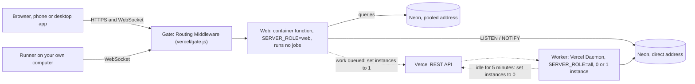
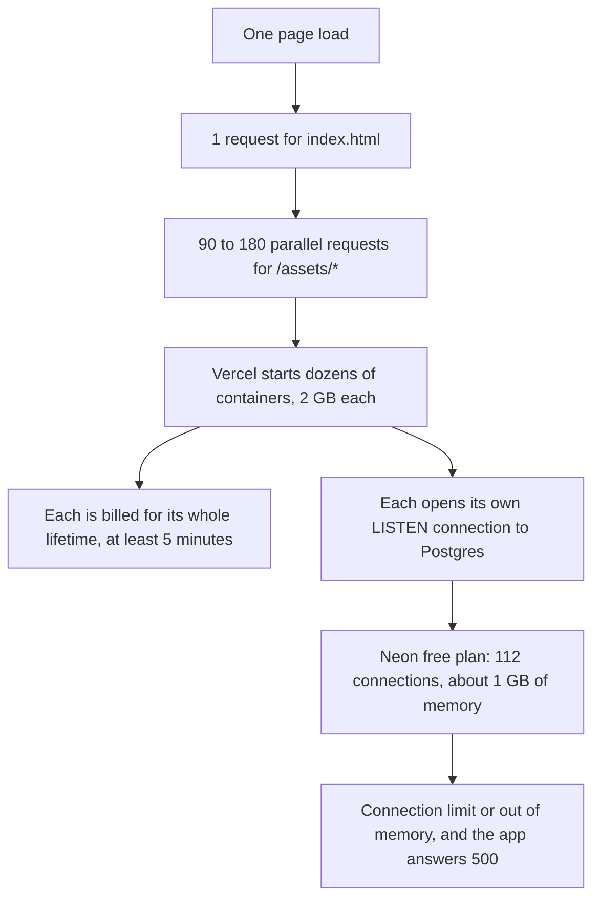

<h1 align="center">Nothing always on</h1>

  <b>An experiment: running <a href="https://github.com/agentes-chat/agentes-chat">agentes.chat</a> entirely on Vercel, with every part switched off while idle.</b>

  
  
  
  

  <a href="#the-verdict">Verdict</a> ·
  <a href="#what-was-built">What was built</a> ·
  <a href="#where-everything-stands">Status</a> ·
  <a href="#the-blocker-container-fan-out">The blocker</a> ·
  <a href="#what-it-cost">Cost</a> ·
  <a href="#what-we-learned">Learnings</a> ·
  <a href="#what-to-do-next">Next steps</a>

> [!WARNING]
> **Paused on 13 November 2026.** This is an unofficial, personal fork and it is not production
> ready. It ran, but it cost about **US$14 in its first 20 hours** for one person. Do not deploy
> this branch expecting it to be cheap. If you just want to run agentes.chat, use
> [upstream's installer](https://github.com/agentes-chat/agentes-chat#quick-start) on a small
> always-on server.

## The verdict

agentes.chat is built as **one long-running process** beside Postgres. This fork tried to run it on
Vercel for one person, with no always-on machine, no always-on bill and no per-minute cron.

- **It worked functionally.** Chat, agents, the job runner waking on demand and sleeping when idle
  all ran on Vercel and Neon, in Sydney.
- **It failed on cost and stability.** Vercel starts a new copy of the whole server for bursts of
  requests. One page load could start dozens of 2 GB containers, each billed for at least five
  minutes and each holding its own database connection. See [the blocker](#the-blocker-container-fan-out).
- **Nothing ever reached zero.** A connected agent computer keeps one container up and wakes the
  job runner about every five minutes.

There is a credible next step (serve the app's static files from Vercel's CDN), but it is untested
and may not be enough on its own.

## The goal

| Constraint | Why |
| --- | --- |
| No always-on machine | The only computer available is a low-powered laptop |
| No always-on billing | Personal, non-commercial use: a few hours a day at most |
| No per-minute cron or polling that costs | Paying to check whether there is work defeats the point |
| Everything on Vercel (Pro plan) | One bill, one dashboard, and the plan's US$20 monthly credit |

## What was built

| Part | What it is | File |
| --- | --- | --- |
| **Web** | The stock server in a new `web` role: UI, API and sockets, no job loops. Runs as a Vercel container function. | [`Dockerfile.vercel`](Dockerfile.vercel), [`apps/server/src/workers.ts`](apps/server/src/workers.ts) |
| **Worker** | The stock image with every role, as a Vercel Daemon that is scaled between 0 and 1 instance. Runs jobs, routines and agent runs with no time limit. | [`vercel.json`](vercel.json), [`Dockerfile`](Dockerfile) |
| **Worker switch** | One `PUT` to Vercel's REST API. The web role wakes the worker when work is queued; the worker switches itself off after five idle minutes. | [`worker-switch.ts`](apps/server/src/worker-switch.ts), [`idle-sleep.ts`](apps/server/src/idle-sleep.ts) |
| **Database** | Neon free plan. Queries go through Neon's pooler; only `LISTEN` and migrations use the direct address. | [`packages/db/src/client.ts`](packages/db/src/client.ts) |
| **Gate** | Routing Middleware that holds requests during a cold start until one container answers a health check, so a burst does not start one container each. | [`vercel/gate.js`](vercel/gate.js) |
| **Idle tabs** | A tab that is hidden for 3 minutes or untouched for 15 closes its socket and stops polling, and reconnects on return. | [`apps/web/src/lib/away.ts`](apps/web/src/lib/away.ts) |
| **Default agent fallback** | When the computer holding the default agent's AI sign-in is offline, it follows the same sign-in to another computer that is online. | [`packages/engine/src/right-hand.ts`](packages/engine/src/right-hand.ts) |

Agents' computers were ordinary machines running the upstream runner, connected over a WebSocket
through the web function. The original plan put the runner inside the worker; that was not built.

## Where everything stands

✅ verified in production · 🟡 deployed, not verified · ❌ failed or unsolved · ⬜ not started

| | Piece | Evidence or gap |
| --- | --- | --- |
| ✅ | Daemon builds from the monorepo root and starts on demand | Scale 0 to 1, serving about 11 seconds later |
| ✅ | Web role as a container function | UI, API and live chat work |
| ✅ | Wake path, end to end | First message with the worker off woke it and the agent answered |
| ✅ | Worker idle sleep | Logged "no work: switching the job runner off" and scaled to 0 |
| ✅ | Queries through the pooler | About 1.6 connections per container instead of about 4 |
| ✅ | `maxConcurrency` applied to the container | Deployment inspect shows `maxConcurrency: 500` |
| 🟡 | Gate holding a cold start | Works in a quiet window; the one clean cold test was spoiled by a live storm |
| 🟡 | Idle-tab disconnect | Logic tested in isolation; never observed taking a real tab away |
| 🟡 | Default agent fallback | Never exercised: only one computer had a sign-in |
| ❌ | Vercel's Bun preset (no container) | Its bundler rejects the server's text imports |
| ❌ | Function `affinity` to pin requests to one instance | Every request returned 403 `FUNCTION_AFFINITY_FORBIDDEN` |
| ❌ | **Stopping container fan-out** | **Unsolved. This is the blocker** |
| ❌ | Scale to zero with a computer connected | Its socket keeps a container up and wakes the worker about every 5 minutes |
| ⬜ | Timed alarm for scheduled work | With the worker off and no tab open, routines do not fire |
| ⬜ | File storage on Vercel Blob | Container disks are ephemeral; uploads were never addressed |
| ⬜ | Migrations as a deploy step | The worker migrates when it boots, so web can briefly run ahead of the schema |
| ⬜ | Runner inside the worker, or Vercel Sandbox as an agent's computer | Designed, not built |
| ⬜ | Type check, lint, full test suite, CI | **None of the fork's TypeScript has been type-checked.** See [code health](#code-health) |

## The blocker: container fan-out

Upstream expects one process to hold every request, socket, cache and database pool. A Vercel
container function behaves differently: by default it gives each concurrent request its own
instance, and each instance boots the **whole server**.

What was measured:

| Test | Result |
| --- | --- |
| First request, default settings | 9 containers started at once; about 13 stayed alive with no traffic |
| Default pool of 20 per container | All 112 connections used; every new start failed and restarted in a loop |
| `maxConcurrency: 500`, one warm container, 80 parallel health checks | Absorbed by the one container |
| Same, 60 parallel requests for `/` | Absorbed by the one container |
| Same, **90 parallel requests for real `/assets/*` files** | **68 new containers** |
| Deploying while a tab is open (gate skipping `/assets`) | 21 containers |
| Deploying while a tab is open (gate on every path) | 74 containers; database at its connection limit |
| A build that had been live for 80 minutes | 77 containers from one burst of asset requests |

Three things follow from this:

1. **`maxConcurrency` is not a cap on instances.** One warm container absorbs trivial responses.
   Responses that stay in flight longer still make Vercel start more.
2. **The gate only helps during a cold start.** It makes the first burst wait for one container.
   It cannot stop the scale-out that happens once real responses are flowing.
3. **The CDN was not shielding the container.** Asset requests reached the container on a build
   that had been live for over an hour. The app serves its own files from the container; they need
   to be static files that Vercel serves without touching it.

## What it cost

Vercel's bill for this project alone, from the first deploy to the pause, roughly 20 hours:

| Service | Quantity | Cost (US$) |
| --- | ---: | ---: |
| Fluid Provisioned Memory (Custom Scaling) | 194.8 GB-hours | 5.80 |
| Build CPU Minutes | 900 minutes | 3.15 |
| Fluid Provisioned Memory | 130.5 GB-hours | 1.94 |
| Fluid Active CPU | 9.0 hours | 1.63 |
| Container registry storage | 8.0 GB | 0.80 |
| Daemons Provisioned Memory | 19.4 GB-hours | 0.58 |
| Daemons Active CPU | 0.6 hours | 0.10 |
| Everything else | | 0.09 |
| **Total** | | **14.09** |

How to read it:

- **This is a day of experimenting, not a steady-state price.** It includes several container
  storms and 19 deployments, five of which failed to build. A steady-state cost was never measured.
- **Memory is the bill.** Web container memory was US$7.74 of the total. Containers are billed for
  provisioned memory for as long as they exist, whether or not they are doing anything.
- **Turning on `maxConcurrency` doubled the memory rate.** As billed, "Custom Scaling" memory came
  to about US$0.030 per GB-hour against about US$0.015 for standard. Those are derived from this
  bill, not from published pricing.
- **The worker was the cheap part.** The daemon cost US$0.68.
- **The plan's estimate was wrong by an order of magnitude.** Before deploying, the estimate was a
  few dollars a month at two active hours a day, inside the Pro plan's US$20 credit. In practice
  the credit was gone within the day.

## What we learned

### Vercel

- **The Bun preset re-bundles your entry.** It could not build this server because of its text
  imports, so a container function was the only way to run the real Bun binary.
- **A container function is not a server.** Expect many instances. Anything the app does once per
  process (a pool, a `LISTEN` connection, caches, timers) happens once per instance.
- **Scale-in takes about five minutes** in production, so every burst is billed as
  `instances × memory × 5 minutes` at minimum.
- **Every deploy is a cold start.** Promoting a build while a tab is open triggers a storm on the
  new deployment. Stage with `--skip-domain` and promote when nothing is open.
- **`maxConcurrency` (beta) needs explicit `builds`.** With `framework: "container"`, a top-level
  `functions` entry is rejected as unused. It only applies when set under
  `builds[].config.functions`, with `VERCEL_BETA_MAX_CONCURRENCY=1` in the project's environment.
- **Routing Middleware beside a container** also needs an explicit `@vercel/node` build with
  `config.middleware`. On the Node.js runtime the gate itself fanned out (25 cold requests started
  9 containers), so it runs on the edge runtime, which Vercel now flags as deprecated.
- **Function `affinity`** looks like the right switch for an app like this and is not available to
  an ordinary Pro team. Whether support can enable it is unknown.
- **Daemons are good.** They build from a monorepo root, start in about 11 seconds, keep their
  instance count across deploys and scale by a single REST call. A daemon that exits is restarted,
  so it has to ask to be scaled down.
- **Function sockets are cut about every five minutes.** Browsers reconnect quietly. A runner
  reconnects too, and each drop has side effects (see below).
- **Builds add up.** About US$0.17 per deployment on average here, on a larger build machine that
  was selected automatically, plus registry storage for the images.

### Neon and Postgres

- **The free plan's real limit is memory, not connections.** With about 1 GB and a backend that
  grows to roughly 7.5 MB once it has touched every table, the database failed with
  `could not fork new process for connection: Cannot allocate memory` before reaching 112.
- **Use both addresses.** `LISTEN/NOTIFY`, the migration lock and prepared statements need the
  direct address. Ordinary queries can go through the pooler with prepared statements off.
- **The pooler does not fix fan-out.** Every container still holds one direct connection for
  `LISTEN`. At the worst point there were 80 listeners.
- **Open containers keep the database awake.** Each one queries on a 30-second heartbeat, so Neon
  has no idle period to suspend in while any container is alive. Expected from the code; not
  measured.

### The app's design

- **The single-process assumption runs deep.** Pub/sub, caches, presence and the computers' sockets
  all assume one long-lived process. Splitting web from jobs was the easy part.
- **Wake hooks miss work.** About 45 routes signal the job runner after a write, but there are well
  over 100 places that queue a job. The web role needs a backstop check for waiting work, which is
  a form of the polling this project set out to avoid.
- **A connected computer defeats scale-to-zero.** Its socket is cut every five minutes. Each cut
  queues an "is it offline?" job due two minutes later, and that job wakes the worker: 156 times in
  14 hours here, most of them overnight with nobody using the app.
- **The default agent is tied to one computer.** It thinks with the AI sign-in on a single
  computer, and by design that never moves on its own. If that computer is offline, every
  conversation fails, even with another one online.
- **"Add your AI" is the provider's price, not the app's.** Self-hosting is free. Agents need
  either a model API key or a subscription signed in on a connected computer.
- **The desktop and phone apps open the hosted Cloud by default.** Point them at your own server
  on the sign-in screen.

## What to do next

In order. Each step should be proven on a staged deployment, with test bursts of about 25 requests
and the database's headroom checked first.

1. **Serve `/assets` from Vercel's CDN.** Build the web app as static output beside the container
   so those requests never reach it. Pass: with the container cold, fetching every asset starts
   zero containers.
2. **Measure an API-only burst.** A page load also fires parallel API calls. If those fan out too,
   step 1 is not enough and the approach needs a different host for the web role.
3. **Drop the per-container `LISTEN` connection.** Connect lazily, or only when a socket is open,
   so a storm cannot exhaust the database.
4. **Stop a connected computer from keeping things up.** Options: do not wake the worker for the
   offline check, connect the runner to the worker instead of a function, or lean on upstream's
   "computers that sleep" design.
5. **Ask Vercel about function `affinity`.** If one instance can be made to take everything, most
   of this goes away.
6. **Re-test the gate cold**, then move it off the deprecated edge runtime.
7. **Verify the idle-tab change and the default agent fallback** against real use.
8. **Add the alarm.** A delayed Vercel Queues message for the next due time, so routines fire while
   everything is off.
9. **Storage and migrations.** A Vercel Blob adapter, and migrations as a build step.
10. **Bring the code up to upstream's rules.** See below.

If step 2 fails, the honest answer is that this app wants one small always-on box. A database that
can absorb the bursts (a larger Neon compute) would hide the stability problem but not the bill.

## Code health

This branch was written in a day without a local toolchain, and it does not meet upstream's own
[contribution rules](CONTRIBUTING.md) yet:

- No type check, lint, boundary check or CI run. The idle-tab logic was tested only after
  transpiling outside Bun.
- `.env.example` was not regenerated for the new variables.
- The `web` role and the worker switch are architecture decisions with no ADR.
- [`server.ts`](server.ts) at the root is a leftover from the failed Bun-preset attempt.
- The worker switch's default bodies name the `iad1` region; this deployment overrode them.
- The branch is several hundred commits behind upstream.

## Running it

Not recommended, for the reasons above. For reference, the fork's own settings:

| Variable | Where | Purpose |
| --- | --- | --- |
| `SERVER_ROLE=web` | Web | Serve the app, run no jobs |
| `RUN_MIGRATIONS_ON_BOOT=false` | Web | The worker migrates instead |
| `DATABASE_URL` | Both | Direct Postgres address |
| `DATABASE_POOLED_URL` | Web | Pooler address for ordinary queries |
| `DATABASE_POOL_MAX` | Both | 10 on web, 15 on the worker |
| `WORKER_WAKE_URL`, `WORKER_WAKE_TOKEN` | Both | Vercel's "set daemon instances" endpoint and an access token |
| `WORKER_WAKE_BODY`, `WORKER_SLEEP_BODY` | Both | `{"<region>":1}` and `{"<region>":0}` |
| `WORKER_IDLE_SLEEP_SECONDS` | Worker | Idle time before switching off (default 300) |
| `VERCEL_BETA_MAX_CONCURRENCY=1` | Project | Opts in to `maxConcurrency`, at the higher memory rate |

Everything else is upstream's configuration: see [SELF_HOSTING.md](SELF_HOSTING.md).

<b>Every file this fork touches</b>

| File | Change |
| --- | --- |
| `vercel.json` | Container function, worker daemon, gate, `maxConcurrency` |
| `Dockerfile.vercel` | Web image |
| `vercel/gate.js`, `vercel/package.json` | Cold-start gate |
| `server.ts` | Unused Bun-preset entry |
| `apps/server/src/start.ts` | `web` role wiring, pooled database, idle watch |
| `apps/server/src/workers.ts` | `startWithoutJobs`, wake hook |
| `apps/server/src/worker-switch.ts` | Wake and sleep calls |
| `apps/server/src/idle-sleep.ts` | Idle detection and the waiting-work backstop |
| `packages/config/src/schema.ts` | New variables and the `web` role |
| `packages/db/src/client.ts` | Pooled client plus a direct listener |
| `packages/engine/src/right-hand.ts` | Default agent fallback |
| `packages/client/src/realtime/connection.ts` | Activity signal for the away watch |
| `apps/web/src/lib/away.ts`, `apps/web/test/away.test.ts` | Away watch and its test |
| `apps/web/src/realtime/context.tsx`, `apps/web/src/main.tsx` | Away watch wiring |

<b>What was tried, in order</b>

1. Bun-preset function from a root `server.ts`: the build failed.
2. Container function plus daemon, in Sydney: worked, then exhausted the database's connections.
3. Smaller pools: stable but fragile.
4. Queries through the pooler: fewer connections per container.
5. Worker idle sleep and the default agent fallback.
6. `maxConcurrency` (after `functions`, `services` and `affinity` all failed): steady state fell to
   two or three containers.
7. Cold-start gate, first on Node.js (fanned out), then on the edge runtime.
8. Idle-tab disconnect.
9. Gate extended to `/assets`: the next deploy started 74 containers. Paused here.

## About agentes.chat

agentes.chat is an open-source, self-hosted workspace where people and AI agents work together in
channels and DMs. Everything about the product itself, its features, apps and supported way to
self-host, is in the [upstream repository](https://github.com/agentes-chat/agentes-chat). The
[`main`](../../tree/main) branch of this fork is an unmodified copy of upstream; the experiment
lives on [`vercel`](../../tree/vercel).

## License and attribution

This fork is licensed, like upstream, under the [GNU AGPL-3.0-only](LICENSE), and its source is
this repository. [NOTICE](NOTICE) carries upstream's additional terms, including the attribution
every copy keeps in its About screen: "Based on agentes.chat by Codari Global, LLC".

"agentes", "agentes.chat" and their logos are trademarks of Codari Global, LLC
([TRADEMARKS.md](TRADEMARKS.md)). This is an independent fork. It is not affiliated with or
endorsed by Codari Global, LLC.
